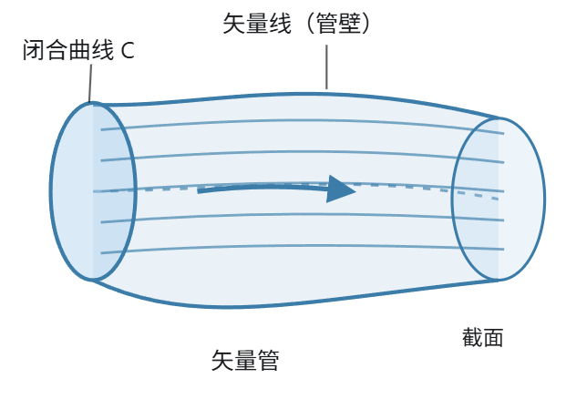
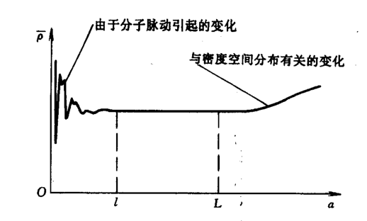
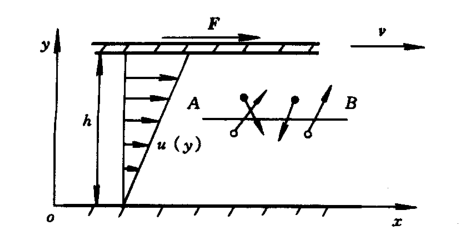

# 基础知识 

## 场论

### 场的定义和分类

设在空间中的某个区域内定义标量函数或矢量函数，则称定义在此空间区域内的函数为场。如果研究的是标量函数，则称此场为标量场;如果研究的是矢量函数，则称之为矢量场。

标量场和矢量场在数学上可表为
$$
\varphi=\varphi(\boldsymbol{r},t)=\varphi(x,y,z,t)
$$

$$
\boldsymbol{a}=\boldsymbol{a}(\boldsymbol{r},t)=\boldsymbol{a}(x,y,z,t)
$$

如果同一时刻场内各点函数的值都相等，则称此场为均匀场，反之称为非均匀场.如果场内函数值不依赖于时间，即不随时间$t$改变，则称此场为定常场，反之称为非定常场，均匀场和定常场在数学上可表为

$$
\varphi(t),\boldsymbol{a}(t)
$$

和

$$
\varphi(\boldsymbol{r}),\boldsymbol{a}(\boldsymbol{r})
$$

### 场的几何表示

取任一固定时刻 $t_0$ 研究场 $\varphi(\boldsymbol{r}, t_0)$ 的几何表示。令

$$
\varphi(\boldsymbol{r}, t_0) = \text{const} = \varphi_0
$$

时，得到与之对应的曲面称为等势面。

矢量线（Vector Line）是指在一个矢量场中，曲线上每一点的切线方向都与该点的矢量场方向一致的曲线。

设空间中存在矢量场：
$$
\boldsymbol A(x,y,z)=A_x\boldsymbol i+A_y\boldsymbol j+A_z\boldsymbol k
$$

矢量线上的微小位移为：
$$
\mathrm d\boldsymbol r=\mathrm dx\,\boldsymbol i+\mathrm dy\,\boldsymbol j+\mathrm dz\,\boldsymbol k
$$

由于矢量线的切线方向与矢量场平行，因此：
$$
\mathrm d\boldsymbol r\times\boldsymbol A=\boldsymbol 0
$$

展开可得矢量线的微分方程：
$$
\frac{\mathrm dx}{A_x}=\frac{\mathrm dy}{A_y}=\frac{\mathrm dz}{A_z}
$$

矢量管（Vector Tube）是指在一个矢量场中，通过一条不与矢量场处处相切的闭合曲线上的各点作矢量线，这些矢量线构成的管状曲面。

### 梯度

大小为 $\dfrac{\partial \varphi}{\partial n}$，方向为 $\boldsymbol{n}$ 的矢量称为标量函数 $\varphi$ 的梯度

$$
\text{grad } \varphi = \nabla \varphi =\frac{\partial \varphi}{\partial n} \boldsymbol{n}
$$

总结起来，梯度的主要性质如下：

1. 梯度 $\text{grad } \varphi$ 描写了场内任一点 $M$ 邻域内函数 $\varphi$ 的变化状况，它是标量场不均匀性的度量；

2. 梯度 $\text{grad } \varphi$ 的方向与等势面的法线重合，且指向 $\varphi$ 增长的方向，大小是 $\boldsymbol{n}$ 方向上的方向导数 $\dfrac{\partial \varphi}{\partial n}$；

3. 梯度矢量 $\text{grad } \varphi$ 在任一方向 $\boldsymbol{s}$ 上的投影等于该方向的方向导数；

4. 梯度 $\text{grad } \varphi$ 的方向，即等势面的法线方向是函数 $\varphi$ 变化最快的方向；

5. 梯度 $\text{grad } \varphi$ 在直角坐标系中的表达式是
$$
\text{grad } \varphi = \frac{\partial \varphi}{\partial x} \boldsymbol{i} + \frac{\partial \varphi}{\partial y} \boldsymbol{j} + \frac{\partial \varphi}{\partial z} \boldsymbol{k}
$$

例：仅与径矢大小有关的标量函数的梯度

设标量场 $\varphi=\varphi(r)$，其中

$$
\boldsymbol r=x\boldsymbol i+y\boldsymbol j+z\boldsymbol k,\quad
r=|\boldsymbol r|=\sqrt{x^2+y^2+z^2}
$$

利用链式法则，

$$
\frac{\partial\varphi}{\partial x}
=\frac{d\varphi}{dr}\frac{\partial r}{\partial x}
=\frac{d\varphi}{dr}\frac{x}{r},\quad
\frac{\partial\varphi}{\partial y}
=\frac{d\varphi}{dr}\frac{y}{r},\quad
\frac{\partial\varphi}{\partial z}
=\frac{d\varphi}{dr}\frac{z}{r}
$$

所以

$$
\begin{aligned}
\nabla\varphi
&=\frac{\partial\varphi}{\partial x}\boldsymbol i
+\frac{\partial\varphi}{\partial y}\boldsymbol j
+\frac{\partial\varphi}{\partial z}\boldsymbol k\\
&=\frac{d\varphi}{dr}
\left(\frac xr\boldsymbol i+\frac yr\boldsymbol j+\frac zr\boldsymbol k\right)\\
&=\frac{d\varphi}{dr}\frac{\boldsymbol r}{r}
\end{aligned}
$$

### 散度

假设空间中存在一个矢量场

$$
\boldsymbol Q=Q_x\boldsymbol i+Q_y\boldsymbol j+Q_z\boldsymbol k
$$

对于一个很小的面积元 $dS$，穿过它的通量为
$$
d\Phi=\boldsymbol Q\cdot\boldsymbol n\,dS
$$

把整个曲面上所有面积元的贡献相加，就得到通量：
$$
\Phi=\iint_S\boldsymbol Q\cdot\boldsymbol n\,dS
$$

通常定义矢量面积元
$$
d\boldsymbol S=\boldsymbol n\,dS
$$

于是公式还可以写为
$$
\Phi=\iint_S\boldsymbol Q\cdot d\boldsymbol S
$$

散度的定义：
$$
\operatorname{div}\boldsymbol Q
=\nabla\cdot \boldsymbol Q=\lim_{\Delta V\to0}
\frac{1}{\Delta V}
\oiint_S\boldsymbol Q\cdot d\boldsymbol S
$$

在直角坐标中散度为

$$
\nabla\cdot \boldsymbol Q
=\frac{\partial Q_x}{\partial x}
+\frac{\partial Q_y}{\partial y}
+\frac{\partial Q_z}{\partial z}
$$

我们还学习过Gauss定理：

$$
\oiint_{\partial V}\boldsymbol Q\cdot d \boldsymbol S=
\iiint_V\nabla\cdot\boldsymbol Q\,dV
$$

### 旋度

设有矢量场
$$
\boldsymbol a=a_x\boldsymbol i+a_y\boldsymbol j+a_z\boldsymbol k
$$

空间中存在一条闭合曲线 $L$，称为回线。
矢量 $\boldsymbol a$ 沿回线 $L$ 的环量定义为：
$$
\Gamma=\oint_L\boldsymbol a\cdot\mathrm d\boldsymbol l
$$

旋度在 $\boldsymbol n$ 方向上的分量为
$$
\lim_{\Delta S\to0}
\frac{\Gamma}{\Delta S}
=(\operatorname{rot}\boldsymbol a)\cdot\boldsymbol n
$$

旋度通常用 $\operatorname{rot}$ 或者 $\nabla\times$ 表示：
$$
\operatorname{rot}\boldsymbol a=\nabla\times\boldsymbol a
$$

在直角坐标系中，
$$
\nabla=
\boldsymbol i\frac{\partial}{\partial x}
+\boldsymbol j\frac{\partial}{\partial y}
+\boldsymbol k\frac{\partial}{\partial z}
$$

按照叉乘形式展开：
$$
\operatorname{rot}\boldsymbol a=
\begin{vmatrix}
\boldsymbol i&\boldsymbol j&\boldsymbol k\\
\dfrac{\partial}{\partial x}&\dfrac{\partial}{\partial y}&\dfrac{\partial}{\partial z}\\
a_x&a_y&a_z
\end{vmatrix}
$$

得到
$$
\operatorname{rot}\boldsymbol a
={}\left(\frac{\partial a_z}{\partial y}-\frac{\partial a_y}{\partial z}\right)\boldsymbol i
+\left(\frac{\partial a_x}{\partial z}-\frac{\partial a_z}{\partial x}\right)\boldsymbol j
+\left(\frac{\partial a_y}{\partial x}-\frac{\partial a_x}{\partial y}\right)\boldsymbol k
$$

Stokes公式

$$
\oint_L \boldsymbol{a} \cdot \mathrm{d}\boldsymbol{r} = \int_S \mathrm{rot}_n \boldsymbol{a} \, \mathrm{d}S = \int_S \mathrm{rot} \boldsymbol{a} \cdot \mathrm{d}\boldsymbol{S}
$$

## 张量初步

### 张量的定义

我们可以先把二阶张量理解为：一种能够把矢量映射为另一个矢量的线性关系。

数学上：
$$
\boldsymbol b=\boldsymbol T\cdot\boldsymbol a
$$

其中：
- $\boldsymbol a$：输入矢量
- $\boldsymbol T$：二阶张量
- $\boldsymbol b$：输出矢量

在三维直角坐标系中，二阶张量可以表示为：

$$
\boldsymbol T=
\begin{bmatrix}
T_{11}&T_{12}&T_{13}\\
T_{21}&T_{22}&T_{23}\\
T_{31}&T_{32}&T_{33}
\end{bmatrix}
$$

它看起来就是一个 $3\times3$ 矩阵。但需要注意：矩阵是张量在选定坐标系下的一种表示，张量本身并不依赖于坐标系。

二阶张量

$$
p'_{ij}=\alpha_{il}\alpha_{jm}p_{lm}
$$

推广到$n$阶张量

$$
p'_{i_1i_2\cdots i_n}=
\alpha_{i_1j_1}
\alpha_{i_2j_2}
\cdots
\alpha_{i_nj_n}
p_{j_1j_2\cdots j_n}
$$

### 张量的代数运算

#### 加减法与数乘
1. 加减法

   两个同阶张量可以相加减，对应分量分别相加减：

$$
C_{ij}=A_{ij}+B_{ij}
$$

2. 张量的数乘

   张量的每一个分量都乘上同一个标量：

$$
B_{ij}=\lambda A_{ij}
$$

#### 张量积（外积）
设有两个矢量$\boldsymbol a,\boldsymbol b$，它们的张量积定义为：

$$
\boldsymbol T=\boldsymbol a\otimes\boldsymbol b
$$

分量形式：
$$
T_{ij}=a_i b_j
$$

#### 缩并
缩并就是把一个张量的两个指标取成相同的指标，然后对该指标求和。例如，二阶张量：

$$
\boldsymbol A=
\begin{bmatrix}
1&2\\
3&4
\end{bmatrix}
$$

其分量为 $A_{ij}$。
现在令 $i=j$，并求和：
$$
A_{ii}=\sum_i A_{ii}
$$

在二维情况下：
$$
A_{ii}=A_{11}+A_{22}=1+4=5
$$

得到一个标量。这正是矩阵的迹：
$$
A_{ii}=\operatorname{tr}(\boldsymbol A)
$$

一般地，对一个张量进行一次缩并，会使其阶数降低 2。

#### 内积

1. 两个矢量的点积

   对于两个矢量：

$$
\boldsymbol a\cdot\boldsymbol b=a_i b_i
$$

矢量的点积可以理解为张量积后进行一次缩并。

2. 二阶张量与矢量的点积

$$
\boldsymbol c=\boldsymbol A\cdot\boldsymbol b
$$

写成分量形式：
$$
c_i=A_{ij}b_j
$$

3. 两个二阶张量的乘积

$$
C_{ij}=A_{ik}B_{kj}
$$

这也是一次缩并，因为 $k$ 出现两次。
但 $i,j$ 保留下来，所以结果仍为二阶张量。
展开后就是矩阵乘法：
$$
\boldsymbol C=\boldsymbol A\boldsymbol B
$$

#### 双重缩并（双点积）

有时我们需要在两个二阶张量之间进行两次缩并。
例如：
$$
\boldsymbol A:\boldsymbol B=A_{ij}B_{ij}
$$

注意右侧的两个重复指标 $i,j$，都需要求和。
对于二维张量：
$$
\boldsymbol A:\boldsymbol B=
A_{11}B_{11}+A_{12}B_{12}
+A_{21}B_{21}+A_{22}B_{22}
$$

结果是标量。
比如：
$$
\boldsymbol A=
\begin{bmatrix}1&2\\3&4\end{bmatrix},\qquad
\boldsymbol B=
\begin{bmatrix}2&0\\1&3\end{bmatrix}
$$

那么：
$$
\boldsymbol A:\boldsymbol B
=1\times2+2\times0
+3\times1+4\times3
=17
$$

### 二阶张量

#### 主值、主轴及不变量

有些特殊方向满足：
$$
\boldsymbol A\boldsymbol n=\lambda\boldsymbol n
$$

即：张量作用于这个方向的矢量后，只改变其大小或指向，不改变所在的直线。

这里：
- $\lambda$ 称为张量的主值，即特征值。
- $\boldsymbol n$ 称为对应的主方向，即特征向量的方向。
- 沿主方向的直线称为主轴。

有些量不会因为坐标系旋转而改变，它们叫作张量不变量。

三维二阶张量有三个常用的主不变量：
$$
I_1=\operatorname{tr}(\boldsymbol A)=\lambda_1+\lambda_2+\lambda_3
$$

$$
I_2=\frac12\left[(\operatorname{tr}\boldsymbol A)^2-\operatorname{tr}(\boldsymbol A^2)\right]=\lambda_1\lambda_2+\lambda_2\lambda_3+\lambda_3\lambda_1
$$

$$
I_3=\det(\boldsymbol A)=\lambda_1\lambda_2\lambda_3
$$

#### 共轭张量、对称张量和反对称张量

设 $\boldsymbol{P} = p_{ij}$ 是一个二阶张量，则$\boldsymbol{P} _ c =p_{ji}$也为一个二阶张量，称为 $\boldsymbol{P}$ 的共轭张量。

若满足$p_{ij}=p_{ji}$，则称此张量为对称张量。

若满足$p_{ij}=-p_{ji}$，则称此张量为反对称张量。
#### 张量的分解

任意二阶张量都能够唯一分解成一个对称张量和一个反对称张量：
$$
\boldsymbol A=\frac{\boldsymbol A+\boldsymbol A^T}{2}+\frac{\boldsymbol A-\boldsymbol A^T}{2}=\boldsymbol S+\boldsymbol W
$$

### 二阶反对称张量的性质

三维二阶反对称张量可以写为
$$
\boldsymbol A=
\begin{bmatrix}
0&a_{12}&-a_{31}\\
-a_{12}&0&a_{23}\\
a_{31}&-a_{23}&0
\end{bmatrix}
$$

定义：
$$
\begin{cases}
\omega_1=-a_{23}\\
\omega_2=-a_{31}\\
\omega_3=-a_{12}
\end{cases}
$$

于是

$$
\boldsymbol A=\begin{bmatrix}
0&-\omega_3&\omega_2\\
\omega_3&0&-\omega_1\\
-\omega_2&\omega_1&0
\end{bmatrix}
$$

这样，就可以将反对称张量与矢量建立一一对应关系

$$
\boldsymbol\omega=
\begin{bmatrix}
\omega_1\\\omega_2\\\omega_3
\end{bmatrix}
$$

所以有

$$
\boldsymbol A\cdot\boldsymbol b
=\boldsymbol\omega\times\boldsymbol b
$$

### 张量的微分运算

张量的梯度：

$$
\nabla\boldsymbol P
=\operatorname{grad}\boldsymbol P
=\frac{\partial p_{i_1i_2\cdots i_n}}{\partial x_k}
$$

张量的散度

$$
\nabla\cdot\boldsymbol P
=\operatorname{div}\boldsymbol P
=\frac{\partial p_{k i_2\cdots i_n}}{\partial x_k}
$$

# 流体的物理性质和运动的描述

## 流体的物理性质

### 连续介质假设

如果从微观入手，

$$
\frac{F_i}{m}=\frac{\mathrm{d}u_i}{\mathrm{d}t}
$$

但统计结果难以反映宏观力学性质，因此目前研究宏观运动一般都借助宏观方法。

设某一时刻，在流体中取一立方体，当立方体体积 $V$ 或其边长 $a$ 向一点趋于零时，就得到流体中该点处单位体积的平均质量即平均密度值 $\bar{\rho}$ 的变化过程

$$
\bar{\rho}=\frac{\sum m_i N_i}{V}
$$

其中$l$为粒子结构尺度$(\sim 10^{-9}\mathrm m)$，$L$为宏观密度显著变化的尺度$(>10^{-5}\mathrm m)$

为满足统计平均，我们一般取$l\ll a \ll L$，此时我们定义克努森数（Knudsen Number）

$$
Kn=\frac{l}{a}\ll 1
$$

连续介质力学：忽略物质的微观分子结构，将流体视为连续充满空间的介质，其密度、速度、压强、温度等宏观物理量都是空间和时间的连续函数。

流体质点（流体微团）是包含大量分子的微小流体单元。有两个特点：

- 微观足够大： 包含大量分子，可以得到稳定的统计平均物理量。

- 宏观足够小： 相对于流场的特征尺度足够小，可以认为其内部宏观物理量近似均匀。

不满足连续介质的例子：

1. 高空稀薄气体，分子自由程达厘米量级，$Kn\gg 1$

2. 芯片微通道流动，“宏观”尺度至微米甚至纳米尺度，$Kn\gg 1$

### 流体的可压缩性和热膨胀性

密度定义为

$$
\rho=\lim_{\delta V\to \delta V^*}\frac{\delta m}{\delta V}
$$

对密度$\rho=\rho(T,p)$做全微分可得

$$
\mathrm d\rho = \frac{\partial \rho}{\partial p} \mathrm dp + \frac{\partial \rho}{\partial T} \mathrm dT
$$

$$
\frac{\mathrm d\rho}{\rho}=\gamma_T \mathrm dp-\beta\mathrm dT
$$

等温压缩系数
$$
\gamma_T=\frac{1}{\rho}\left(\frac{\partial\rho}{\partial p}\right)_T
$$
等温热膨胀系数
$$
\beta=-\frac{1}{\rho}\left(\frac{\partial\rho}{\partial T}\right)_p
$$

对于理想气体我们有
$$
\rho = \frac{p}{RT},\gamma_T=\frac{1}{p},\beta = \frac{1}{T}
$$

可压缩性讨论：

在压强变化较小时，可以近似写成：
$$
\gamma_T\approx\frac{1}{\rho}\frac{\Delta\rho}{\Delta p}
$$

整理得到：
$$
\frac{\Delta\rho}{\rho}\approx\gamma_T\Delta p
$$

因此只要$\gamma_T|\Delta p|\ll1$，密度的相对变化就很小，可以认为密度近似不变。

若$\gamma_T$或$\Delta p$ 很小， 则流体近似不可压。

- $\gamma_T$很小——液体
- $\Delta p$ 很小——压强变化较小的流动

$$
\Delta p=\frac{1}{2}\rho(v_2^2-v_1^2)
$$
- 理想气体，有$\gamma_T=\dfrac{1}{p}$，于是理想气体的等温不可压缩近似条件就是：
$$
\frac{|\Delta p|}{p}\ll1
$$

### 流体的输运性质

三类物理量输运过程：
1. 质量：不同密度（浓度）
2. 动量：不同速度
3. 能量：不同温度

牛顿粘性定律：
$$
F=\mu\frac{v}{h}A,\tau=\frac{F}{A}=\mu\frac{v}{h}
$$

若有速度分布$u(y)$，则流体层$y$处的剪切力为
$$
\tau=\mu\frac{\mathrm du}{\mathrm dy}
$$

其中的系数$\mu$为动力粘度（Dynamic Viscosity），单位为$\text{Pa}\cdot\text{s}=\text{kg}\cdot \text{m}^{-1}\cdot\text{s}^{-1}$

还有一种粘度的定义：运动粘度（Kinematic Viscosity）
$$
\nu = \frac{\mu}{\rho}
$$

剪切应力与应变的一维本构关系：

$$
\tau=\mu\frac{\mathrm du}{\mathrm dy}=\mu\frac{\mathrm d}{\mathrm dy}\left(\frac{\mathrm dx}{\mathrm dt}\right)=\mu\frac{\mathrm d}{\mathrm dt}\left(\frac{\mathrm dx}{\mathrm dy}\right)=\mu\dot{\gamma}
$$

思考：为何任意大小的剪切力都能使流体变形？

$$
\tau\neq 0\Rightarrow\dot{\gamma}\neq 0
$$

如果给定$\tau$，$\mu$增大则$\dot{\gamma}$减小
## 描述流体运动的方法

### 拉格朗日描述（随体法）

### 欧拉描述（空间法）

### 拉格朗日和欧拉描述的相互转换关系

### 随体导数（物质导数、质点导数）

## 迹线、流线、时间线及脉线

### 迹线

### 流线

### 时间线

### 脉线/烟线/染色线

## 流场中一点邻域的相对运动分析

## 作用于流体上的力

## 本构方程